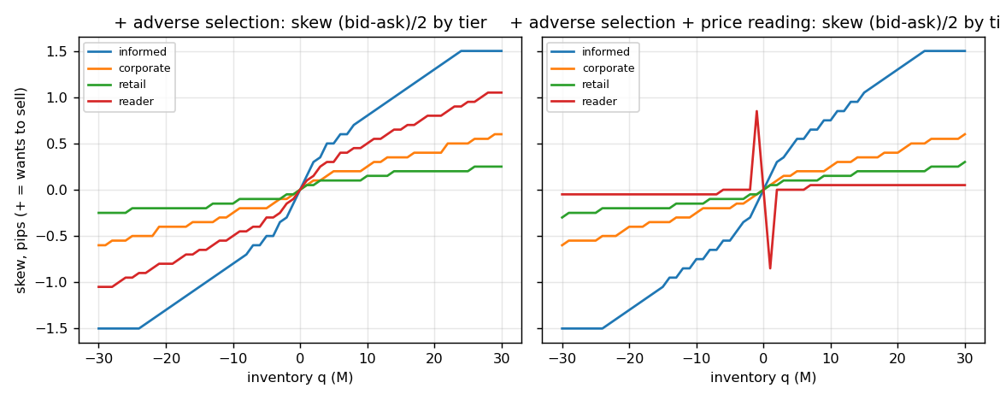
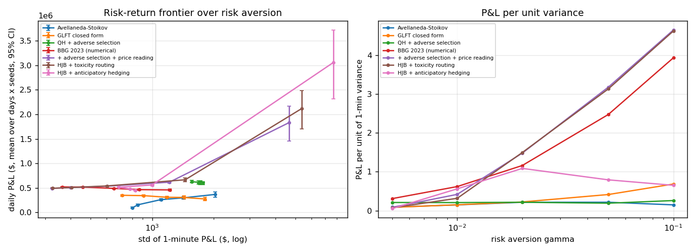

# fx-skew-internalisation

A C++20 FX dealer simulator that solves the dealer's quoting and hedging problem when some clients are informed, some read the dealer's skew, and hedging on the interbank venue has impact. It uses real EURUSD ticks for 14–17 April 2025 as the reference price and a calibrated simulation for the client flow.

The question: how should a dealer skew and hedge when clients are informed or read the skew, and what does the 2025 extension of Barzykin–Bergault–Guéant add over their 2023 model?

## Results

- **Readers lose their skew.** With adverse selection and price reading, the dealer widens quotes to informed clients and steepens their skew. The reader tier is shown a ladder that is flat in inventory (skew slope 0.005 pips/M, against 0.05 without price reading). Every other tier keeps its skew.
- **Adverse-selection losses fall by 82 %.** At γ = 0.02 they go from −$130k to −$23k per day against the 2023 model. P&L per unit of variance rises from 1.16 to 1.48 (+28 %; +18 % at γ = 0.1). That compares the 2023 model with the full 2025 extension, so it combines adverse selection and price reading.
- **It survives a toxicity shock.** With toxicity ×4 at mid-day, the full model goes from $269k to $233k per half-day. The 2023 policy goes from $241k to $56k. Avellaneda–Stoikov and GLFT go negative.
- **Toxicity routing adds little.** A mark-out-scored classifier that decides whether to internalise or hedge adds +1 % in normal conditions and +6 % under the shock. Anticipatory hedging of autocorrelated flow does not pay at the calibrated autocorrelation.
- **Internalisation.** At γ = 0.02 (four days, four seeds) the full model internalises 0.82 of flow, with a median holding time of 125 s.

Skew slopes in pips per M for the informed, corporate, retail and reader tiers:

| model | informed | corporate | retail | reader |
|---|---|---|---|---|
| 2023 | 0.020 | 0.015 | 0.015 | 0.020 |
| + adverse selection | 0.080 | 0.025 | 0.015 | 0.050 |
| + price reading | 0.075 | 0.025 | 0.015 | **0.005** |




All numbers are in `results/summary.md`; the detail is in [docs/method.md](docs/method.md).

## How it works

- **Client layer.** Four tiers with logistic hit probabilities on the offset shown. A trade moves the reference price in the client's direction (adverse selection). Readers trade more on the side that hurts the dealer. A hidden direction switching every ten minutes makes flow autocorrelated.
- **Dealer problem.** An ergodic control problem with a quadratic inventory penalty, hedge cost and permanent impact, solved by relative value iteration. Three nested versions: the 2023 model, plus adverse selection, plus price reading.
- **Closed forms.** Avellaneda–Stoikov (checked against mbt_gym to 5e-10 pips), GLFT and a quadratic-Hamiltonian approximation, used as benchmarks.
- **Toxicity and last look.** An online Bayesian logistic classifier on mark-out features, an anticipatory hedging variant, and a last-look test with the 2025 Global Code hold time.
- **P&L.** An exact decomposition into spread, inventory, adverse selection, hedge execution and hedge impact. The residual is 1e-10 on every run, and 39 tests pass.

## Limitations

- The client layer is simulated. Real single-dealer flow is not public, so every dollar figure scales with calibration targets and none is a measurement.
- Adverse selection is a deterministic post-trade drift and readers know the dealer's direction. This reproduces the 2025 paper's mechanism, not its exact equations.
- The closed form stops hedging when informed drifts are large relative to risk, so the numerical solution is the policy.
- Multi-currency inventory, an RL quoter and a last-look conduct analysis are not done.

## Run

```
cmake -S . -B build -G Ninja && cmake --build build     # or ./build.ps1
./build/fxmm_tests
scripts/run_all.sh
```

CI builds the engine, runs the tests and a synthetic-price pipeline without data.
